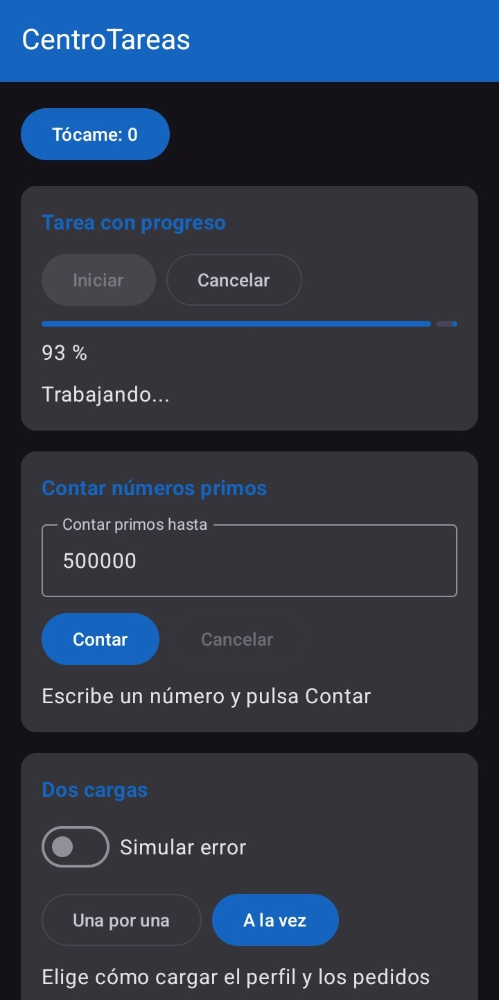
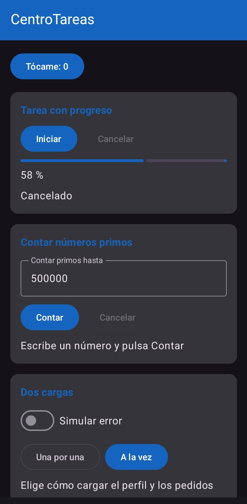
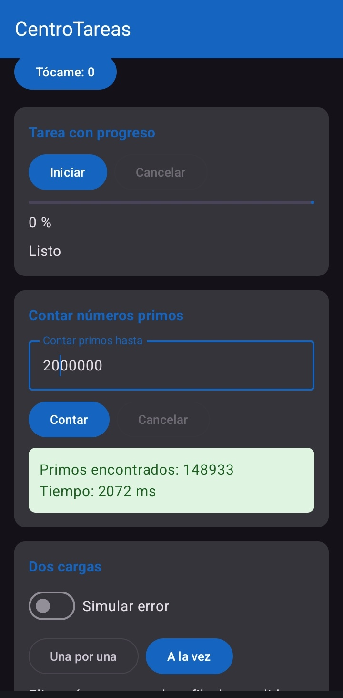
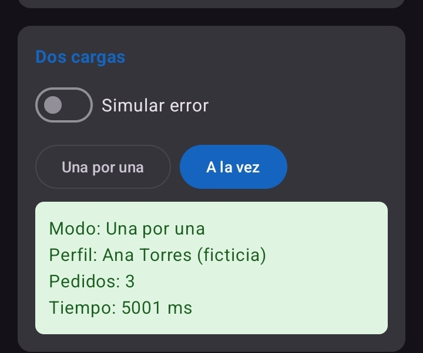
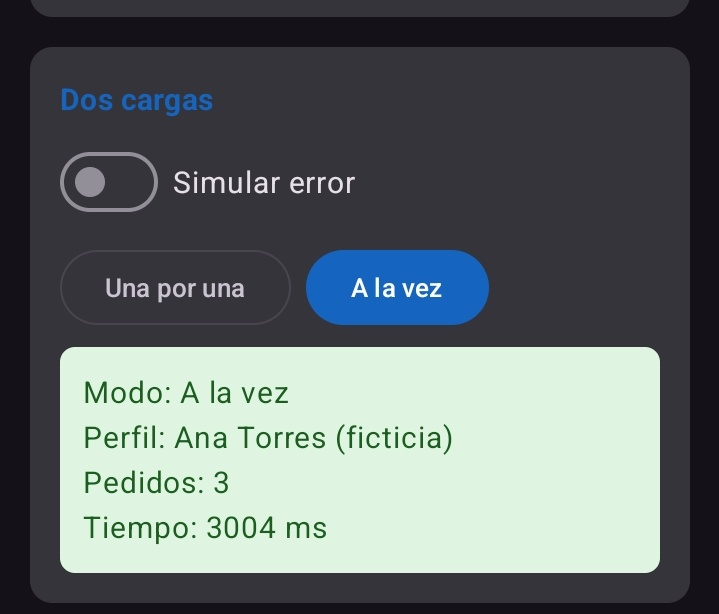
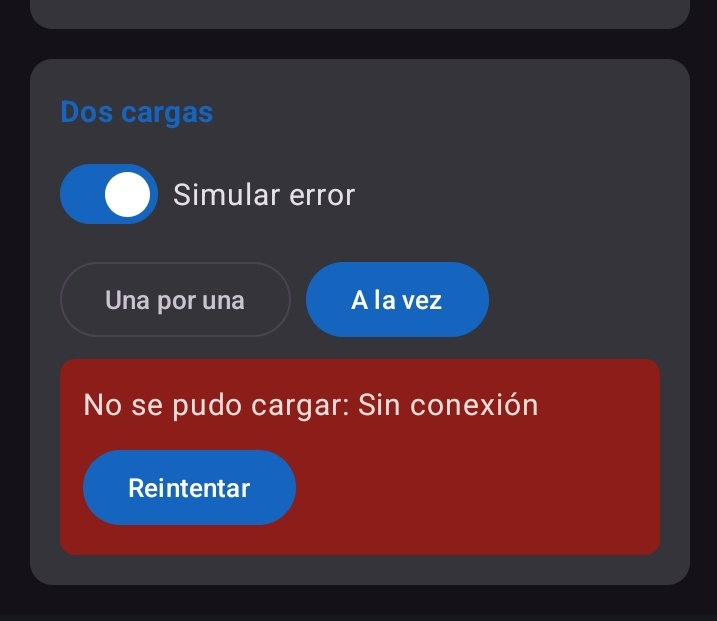

# CentroTareas

**Alumno:** José Rojas Condor
**Curso:** Programación en Móviles — Laboratorio 14: Hilos en Android
**Docente:** Juan León S.

## Descripción

CentroTareas es una app Android hecha con **Kotlin + Jetpack Compose + Material 3** que hace tres cosas que tardan, sin congelar nunca la pantalla:

1. **Tarea con progreso:** una tarea de unos 4 segundos con barra de progreso, que se puede cancelar.
2. **Contar números primos:** un cálculo pesado que se hace en segundo plano y también se puede cancelar.
3. **Dos cargas:** carga un perfil (2 s) y unos pedidos (3 s) simulados, una por una o a la vez con `async`, y muestra cuánto tardó cada forma. Tiene un interruptor para simular un error y un botón Reintentar.

El botón **Tócame** cuenta los toques: es la prueba de vida. Si sigue sumando mientras una tarea trabaja, la pantalla no está congelada.

**Tecnologías:** corrutinas (`viewModelScope`, `launch`, `withContext`, `async`, `Job`), ViewModel + StateFlow, patrón **MVVM + Repository**. Todos los datos son ficticios.

## Estructura de paquetes

```
com.rojas.centrotareas/
├── MainActivity.kt                 Crea el ViewModel con la Factory y muestra la pantalla
├── model/
│   └── Estados.kt                  PrimosUi y CargaUi (estados de pantalla)
├── data/
│   ├── TareasRepository.kt         interface: contarPrimos, cargarPerfil, cargarPedidos
│   └── TareasRepositoryLocal.kt    cargas simuladas con delay y contarPrimos en Dispatchers.Default
├── viewmodel/
│   ├── TareasViewModel.kt          tarea con progreso, primos y cargas (corrutinas y StateFlow)
│   └── TareasViewModelFactory.kt   crea el ViewModel con su Repository
└── ui/
    ├── PantallaTareas.kt           botón Tócame y las tres tarjetas
    └── theme/                      colores y tipografía
```

## Arquitectura MVVM + Repository

```
View (PantallaTareas)
   |  eventos: botones                    ^ collectAsState()
   v                                      |
ViewModel (TareasViewModel) ------ StateFlow ------>
   |  viewModelScope.launch { ... }
   v
TareasRepository (interface) ---> TareasRepositoryLocal
                                  (cargas simuladas y contar primos)
```

| Capa | Conoce a | No hace |
|---|---|---|
| View (`ui/`) | Solo a su ViewModel | No lanza corrutinas ni usa Thread: solo muestra el estado y avisa los eventos |
| ViewModel | Solo a la interface del Repository | No conoce Composables, no recibe Context y no bloquea el hilo principal |
| Repository | Nada de la UI | No expone estados de pantalla; sus funciones `suspend` no bloquean el hilo que las llama |

En el código final **no hay `GlobalScope`, `runBlocking` ni `Thread.sleep`** (comprobado con `git grep`).

## Observación del Paso 1

Al pulsar **Tarea larga (MAL)** la pantalla se congela durante 4 segundos: el botón **Tócame** no suma, los botones no responden y nada se mueve. Después de los 4 segundos aparece directamente **Terminó**.

**¿Por qué no se ve "Trabajando..."?** Porque `Thread.sleep(4000)` se ejecuta en el **hilo principal**, que es el mismo que dibuja la pantalla. El código cambia el mensaje a "Trabajando...", pero el hilo principal se queda dormido antes de poder redibujar; cuando despierta, el mensaje ya cambió a "Terminó", así que solo se ve ese.

**¿Y si la espera fuera de 10 segundos?** Android mostraría el diálogo **"La aplicación no responde" (ANR)**, que aparece cuando el hilo principal está bloqueado unos 5 segundos sin atender los toques, y le ofrece al usuario cerrar la app o esperar.

En el Paso 2 lo arreglé con `viewModelScope.launch` y `withContext(Dispatchers.Default) { delay(4000) }`. En Logcat (filtro `HILO`) se ve `Antes: main`, `Dentro: DefaultDispatcher-worker-…` y `Despues: main`: la espera pasa a un hilo de fondo y el resultado vuelve al principal.

## Capturas

| Tarea con progreso | Tarea cancelada | Primos |
|---|---|---|
|  |  |  |

**Una por una contra a la vez:** la misma carga tarda unos 5000 ms una por una y unos 3000 ms a la vez.

| Una por una | A la vez |
|---|---|
|  |  |

| Error simulado |
|---|
|  |

## Para pensar

**1. ¿Por qué no se veía "Trabajando..." en el Paso 1?**
Porque `Thread.sleep` bloqueaba el hilo principal, que es el único que dibuja la pantalla. El mensaje sí cambiaba a "Trabajando...", pero el hilo se dormía antes de redibujar, y al despertar el mensaje ya era "Terminó". Por eso solo se veía el final, y durante esos 4 segundos la app no respondía a nada.

**2. ¿Qué diferencia hay entre `Thread.sleep` y `delay`?**
`Thread.sleep` **bloquea el hilo** completo: nadie más puede usarlo mientras duerme, y si es el hilo principal la pantalla se congela. Además no se puede cancelar. `delay` es una función `suspend` que **suspende solo la corrutina**: el hilo queda libre para hacer otras cosas (dibujar, atender toques) y la corrutina continúa cuando pasa el tiempo. También revisa la cancelación, por eso en el Paso 4 la tarea se detiene en cuanto pulso Cancelar.

**3. ¿Por qué `Dispatchers.Default` para los primos y `Dispatchers.IO` para la red?**
Contar primos usa mucho **procesador**, y `Dispatchers.Default` tiene tantos hilos como núcleos tiene el celular, que es lo ideal para cálculos. Una llamada de **red** o de disco pasa casi todo el tiempo **esperando** una respuesta sin usar el procesador; `Dispatchers.IO` tiene muchos más hilos para que esas esperas no ocupen los pocos hilos de cálculo. En este lab las cargas son simuladas con `delay`, que no bloquea, por eso no necesitan cambiar de hilo.

**4. ¿Qué pasaría con la corrutina si el usuario cierra la pantalla? ¿Qué papel cumple `viewModelScope`?**
`viewModelScope` está atado a la vida del ViewModel: cuando el usuario sale de la pantalla y el ViewModel se destruye (`onCleared`), **todas las corrutinas lanzadas en ese scope se cancelan solas**. Así no quedan tareas trabajando para una pantalla que ya no existe, sin gastar batería ni causar fugas de memoria. Si solo rota la pantalla, el ViewModel sobrevive, así que la tarea sigue y el progreso no se reinicia.

**5. ¿Por qué `async` tarda 3 s y no 5 s? ¿Qué pasa si una de las dos cargas falla?**
Porque con `async` las dos cargas **empiezan al mismo tiempo**: mientras el perfil espera sus 2 s, los pedidos ya están esperando sus 3 s. El total es el de la más lenta, **máximo(2 s, 3 s) ≈ 3 s**, en vez de la suma 2 + 3 = 5 s. Si una falla, `coroutineScope` **cancela la otra** y lanza la excepción hacia afuera; mi `try/catch` la atrapa (dejando pasar la `CancellationException`) y muestra el recuadro de error con **Reintentar**. No se muestra un resultado a medias.
